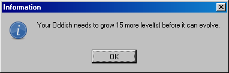
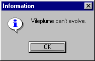
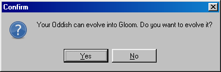
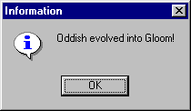
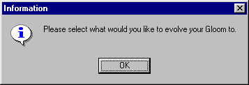
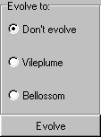
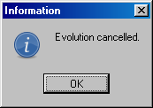
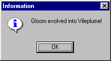

# Evolution

Evolving your POKéMON is quite simple. You select Actions|Evolve a POKéMON, and then double-click the POKéMON you want to evolve in the [Statistics](statistics.md) window. You'll see its statistics, just like you normally would. Once you click OK to this box, one of several different things may happen: (Example used: Oddish/Gloom/Vileplume)

1) Your POKéMON doesn't have a high enough level. You'll be told how many levels it needs to grow before it can evolve: 
2) Your POKéMON can't evolve. You'll see this message: 
3) Your POKéMON can evolve. You'll be asked if you want to evolve it:  
4) Your POKéMON can evolve into one of several different POKéMON:  

Depending on your selection, you will receive one of these two types of messages:  if you chose not to evolve it after all, or  if you evolved it into Vileplume.

Note: In this game, POKéMON can only evolve when they reach a certain level.

A shiny POKéMON stays shiny when it evolves.
