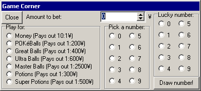
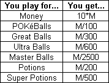

# Game Corner

In the Game Corner, you can see if it's your lucky day! If you have the courage, you can bet money on a number from 0-9, and if that number comes out, you're a winner!

You can win any item in this game, and the more you bet, the more you win!

You start by selecting how much to bet by using the arrows. Whenever you click an arrow, the amount will go up or down by 50¥, but it will never go higher than the amount of money you have. If you want to bet a different amount, you must type it. You can't bet more than you have.

Once that is done, select your prize. Then, select a number from 1-10. If that number comes up, you win X of whatever you played for. To determine X, use the appropriate formula:

, where M is your bet. If a division gives any remainder, the number of items you get is rounded towards zero (the decimals are removed), and the remainder will be paid out as if you had played for money, that is, you will receive 10 times that amount.
