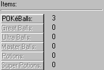
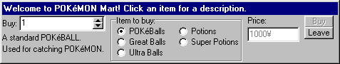

# Items

During battles, you can use items.

Each item has a special function. POKéBalls, Great Balls, Ultra Balls and Master Balls are used for catching wild POKéMON, and Potions and Super Potions are used for restoring HP.

All of these items, except Master Balls, can be bought in the shop, which is found by selecting Actions|Buy Items.

The shop works by selecting the item you want to buy, as well as the amount. When selecting an item, a small description is shown in the bottom-left part of the window. The total price is shown in the small box conveniently labeled "Price:" If you have enough money to buy that amount, the Buy button will be enabled. Once clicked, the amount purchased will be added to your inventory.

NOTE: The buttons that appear during battle will be enabled and disabled as needed. You can only use POKéBalls if you are fighting a wild POKéMON, so those buttons are disabled during trainer battles.
