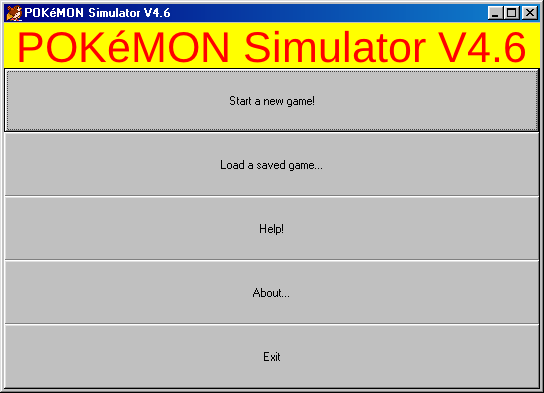
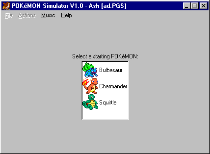
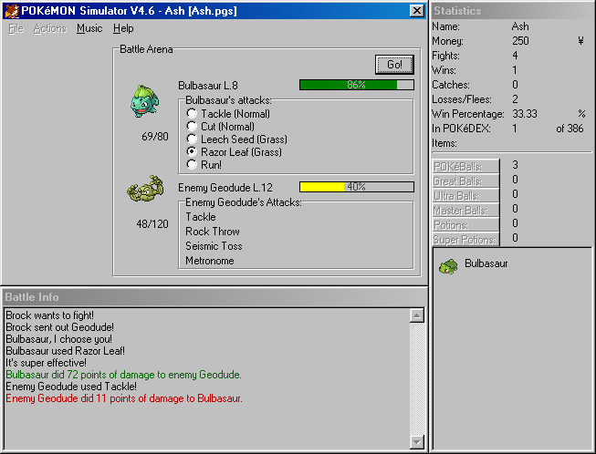

# Playing

After the game has finished loading, you will see this screen:

You have 5 choices here: starting a new game, loading a previously saved game, seeing this help file, seeing a bit of information about the program, or quitting. The last three should be pretty obvious.

When you load a game, you will see a dialog box asking which file to open. This works just like any other open dialog. Just double-click your saved game, and it will be opened instantly.

Clicking "Start a new game..." will ask you to enter your name. This can be up to 15 characters long. The default is Ash. After you have done that, you will be asked to save your game, in a file named after you unless you type another name. This is supposed to happen, as the game will automatically save for you when you quit.

You will then see this screen:

Click the POKéMON you want to start with. There is no such thing as a "wrong" choice, as you can get every POKéMON in the game. Each saved game will store up to 10,000 POKéMON.

Battling goes like this:

Once you start a battle, you must select a POKéMON to fight with by double-clicking it in the [Statistics](statistics.md) window. All you have to do is select which attack to use, and then click the "Go!" button.

When fighting a wild POKéMON, a POKéBALL will show below its hit points if it is already in your POKéDEX.

The Battle Info window (which is only visible during battles) will then show some text telling what happened in that turn. Its lines are coloured by what they tell: the damage your POKéMON deals in green, the damage it takes in red, the experience it gains in blue, and the money you win in gold. Critical hits are in bold: green when your POKéMON lands one, red when the enemy does. You can turn the colours off in File|Preferences, under Battle Info (see [Menu Items](menus.md)). There is a 10% chance of getting a critical hit, which doubles the amount of damage dealt to the opponent.

Once the battle has been finished, a button labeled "End Fight" appears. This button appears once the outcome of the fight has been decided. While the button is visible, the "Go!" button will be hidden, and you have a chance to review the battle. Click the button to fully end the fight.

After a battle against a POKéMON you searched for, a "Search Again" button also appears, where "Go!" was. It ends the fight and searches again, and your POKéMON comes out again with the same attack selected. F3 does the same. Until you attack, run or throw a ball, you can double-click another POKéMON in the Statistics window to send it out instead, and the next search sends that one.

When your POKéMON comes out, "Go!" has the focus, so Enter attacks.

If you lose the fight, your money will be cut in half.

Also see the rest of this help file for more information on battling.

You'll have to fight Gym Leaders if you want to progress. Every time you beat a new Gym Leader, you can battle the next one. However, there are some exceptions...

- Brock, the first Kanto Gym Leader, can be fought right away.
- After beating Gary, the final Kanto Leader, you must battle the Johto Elite Four before you can take on the Johto Leaders.
- After beating the final Johto Leader, you will be able to fight Ash.
- Once you have beat Ash, you can fight me. And once you have beaten me, Mewtwo and the Hoenn Gyms is unlocked.
- Catching Mewtwo will unlock a secret. This secret is in effect as long as you have a Mewtwo. You can only have one Mewtwo at a time.
- The Kanto Elite Four and the Hoenn Elite Four can be fought once you have defeated all 8 Hoenn Gym Leaders. They use L.100 POKéMON. Defeat them to get a special prize.

Other parts of the game depend on your progress. For example, certain wild POKéMON won't appear until you have progressed far enough.

Certain POKéMON cannot be found by facing wild POKéMON:

- The evolutions of Eevee (Vaporeon, Jolteon, Flareon, Espeon and Umbreon) never appear in the wild. You must evolve them from Eevee.
- Mewtwo must be unlocked by beating me, after which he can be fought by selecting Mewtwo from the menu. You can't have more than one Mewtwo (unless you win one), but he can be caught again if you release him.
- Mew, Celebi, Jirachi and Deoxys are given to you after completing certain tasks. You can't get more than one by repeating the task, but it is possible to have more than one of each...

The following POKéMON have special rules in comparison to the original Game Boy games:

- Shedinja: Shedinja is not restricted to 1HP. 75% of the time, when you evolve a Nincada into Ninjask, you will also receive a Shedinja. In the original games, you get it if you have a free space in your party when you evolve Nincada into Ninjask.
