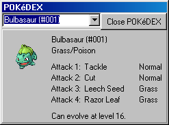

# POKéDEX

The POKéDEX allows you to see various facts about each and every POKéMON.

As the picture above shows, you can see the POKéMON's name, number, appearance, type(s), and info about evolving the POKéMON. Also, if you have had the POKéMON, you can see its attacks and their types. To search, type the name of the POKéMON. In the case of Mew, type "Mew " without the quotes. Note the space at the end.

To see what a POKéMON looks like when it's shiny, check the Shiny box below its picture. This works for every POKéMON, even those you haven't caught yet.

When you select a POKéMON, it will first play its animation from POKéMON Emerald. If you'd rather not see it, it can be turned off in [Preferences](preferences.md).

You can see how many POKéMON have their attacks in the POKéDEX in the [Statistics](statistics.md) window.

NOTE: This game uses “Old POKéDEX” sorting. This basically means that the “old” 251 POKéMON (Bulbasaur-Celebi) have retained their original numbers, and the new have been appended in the same sequence as they appear in the New POKéDEX. The New POKéDEX is that used in POKéMON Ruby/Sapphire.
