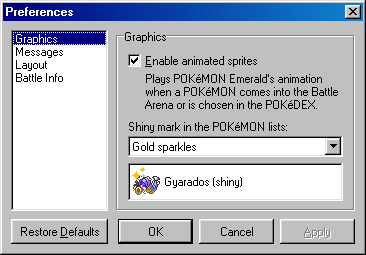
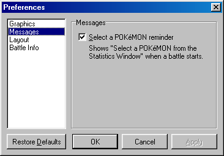
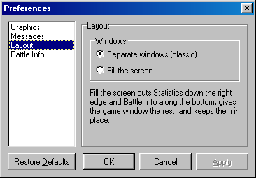
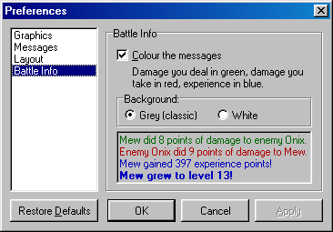

# Preferences

The Preferences window lets you change a few things about how the game looks and behaves. To open it, select File|Preferences... in the game window. The categories are listed on the left. Click one to see its options.

**Graphics**

Enable animated sprites: When this is checked, a POKéMON plays its animation from POKéMON Emerald when it enters the Battle Arena. The wild POKéMON plays it when it appears, and yours when you choose it. The [POKéDEX](pokedex.md) also plays it for the POKéMON you select there. Uncheck it if you only want to see the still pictures.

Shiny mark in the POKéMON lists: Shiny POKéMON have a small mark on their icon in the [Statistics](statistics.md) window, and on their picture when you choose your first POKéMON. Here you can choose which mark to use, or None if you don't want one. The box below the list shows what it will look like. See [Playing](playing.md) for more about shiny POKéMON.

**Messages**

Select a POKéMON reminder: Every battle starts with a message telling you to select a POKéMON from the Statistics window. Once you know how it works, you can uncheck this, and the message won't be shown anymore. The message itself has a "Don't show this message again" box, which does the same thing. Check it here to get the message back.

**Layout**

Separate windows (classic): The game window, Statistics and Battle Info are placed side by side, just like they have always been. You can move them around as you like.

Fill the screen: Statistics goes down the right edge, so you can see more of your POKéMON at once. Battle Info goes along the bottom, where it has room for longer lines, and the game window gets the rest, with the Battle Arena in the middle. The three windows stay in place. Other windows, like the POKéDEX, still open on top of them.

**Battle Info**

Colour the messages: The lines in the Battle Info window are coloured by what they tell. The damage your POKéMON deals is green, and the damage it takes is red. Experience is blue, money you win is gold, the HP a Potion gives back is teal, and a POKéMON added to your POKéDEX is purple. Level ups, catches, fainting, critical hits and shiny POKéMON are in bold too. Everything else, such as the attacks used, stays black. Uncheck this if you want all the lines black.

Background: Grey (classic) is the window's usual colour. White makes it white instead, which some may find easier to read. The box at the bottom shows how the messages will look.

**The buttons**

Restore Defaults puts every option back the way it was when you first played. OK saves your choices and closes the window. Cancel closes it without changing anything. Apply saves your choices but leaves the window open, so you can try another one. Your choices are kept for the next time you play.
