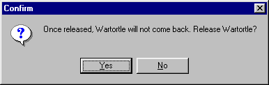
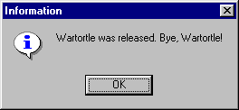

# Releasing

Releasing a POKéMON is quite simple. Select Release a POKéMON from the Actions menu, and double-click the POKéMON to release in the [Statistics](statistics.md) window. You'll be asked to confirm your choice:

If you click Yes, you see this message:

Answering Yes will remove the POKéMON permanently, so use with care!

Note that you can't release your last POKéMON, as that would mean you couldn't play anymore.
