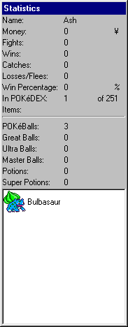

# Statistics

The statistics window shows a variety of things regarding your game, such as how many times you won and lost, your money and items, as well as a complete list of all your POKéMON.

The window shows the following things:

- Player Name
- Your money
- Statistics on your POKéMON Battles
- How many POKéMON are in the POKéDEX
- Your items
- All of your POKéMON

When battling, the item names will change to buttons. Clicking on one of these will use the item.

When clicking on one of your POKéMON, you will see its level and experience.
