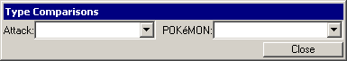
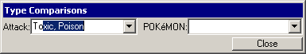
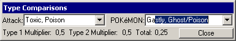

# Type Comparisons

This window lets you see the impact the type of a POKéMON has on any attack.

To use, simply use the drop-down lists to select attack and POKéMON, or type the beginning of the attack or POKéMON in the list box, like this:

 

As soon as you have selected an attack and a POKéMON, the type modifiers are shown. The modifiers are applied using this equation: (damage w/o modifiers)\*(modifiers), so the higher the total, the better.

In the case of Mew, you need to write "Mew," without the quotes. You can also write Mew, and then select it from the list box.

The POKéMON are listed in numerical order as in the POKéDEX.
